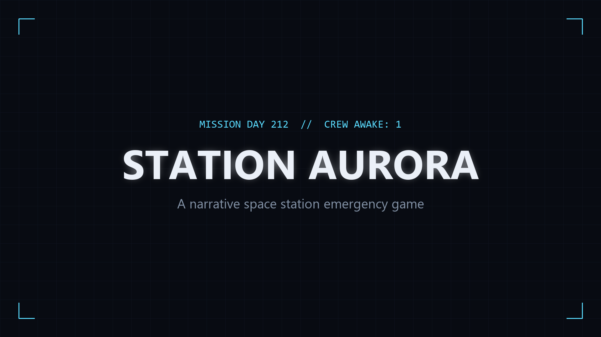
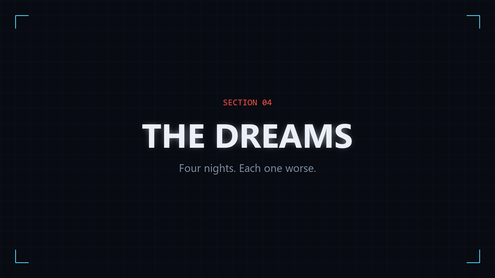
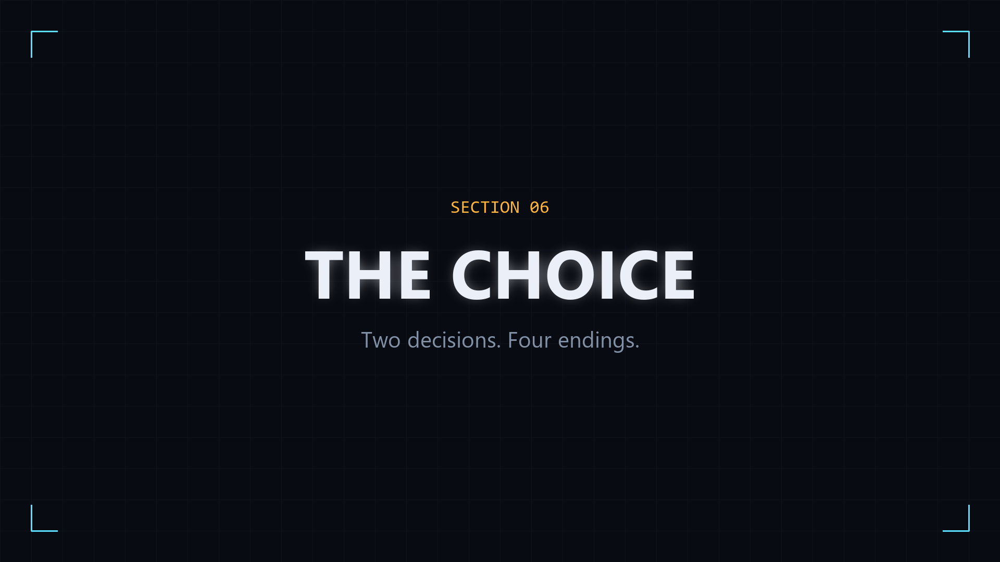

<div align="center">
  

  # Station Aurora

  **The last crew member awake on a dying space station. Every night, an emergency. Is it real, or a dream?**

  
  
  
  
</div>

Station Aurora is a single-player Roblox serious game about emergency response under isolation and stress. You wake on mission day 212: main power is dead, five crew are missing, and AURA, the station AI, is your only company. You get through three mission days of real station work, then four dreams where emergencies spiral out of control. Dream events start leaking into reality, so you can't trust what you see, only your instruments.

> **Pinnacle class project.** Built in Roblox Studio. This repo contains the full game source (47 scripts) and the Arduino controller bridge.

---

## ⚡ Quick start

### 🎮 Play in Roblox Studio
1. Open the place file (`StationAurora.rbxl`) in **Roblox Studio**.
2. Press **Play** (F5).
3. Start from the main menu. The torch switches on by itself; follow AURA.

### 🕹️ Play with the Arduino console (optional)
```bash
cd controller
pip install -r requirements.txt
python bridge.py COM6        # use your Arduino's COM port
```
Click into the Roblox window. The bridge turns the console's buttons and joystick into keyboard input, and reconnects on its own if the USB drops.

---

## How it plays

| Day | Mission day | Title | What you do | That night |
|---|---|---|---|---|
| 1 | 212 | Standby cycle | Torch, restart the backup generator, calibrate life support, file the status report, fix the water recycler, send a distress signal (code **2417**) | Dream 1 + Dream 2 |
| 2 | 213 | Contact | Lock the unknown ship through the telescope, reroute coolant, hail the ship, hear a crew member who isn't aboard | Dream 3 |
| 3 | 214 | Threshold | Recalibrate hull sensors, reroute O2, then choose: **answer the ship** or **pull the comms breaker** | Dream 4, then the final choice |



| # | Dream | Emergency | Can you die? |
|---|---|---|---|
| 1 | System Anomaly | Windows + radar sweep | No |
| 2 | The Foreign Ship | All lights offline, find the ship | No |
| 3 | Power Down | Reset breakers A, B, C; follow the knocking or obey AURA | No |
| 4 | Cascading Failure | O2 critical, open three valves before you black out | **Yes** |

### Endings
Two choices give four endings: answer the ship or stay silent, then **DREAM** (sleep) or **REALITY** (stay awake). Hidden lines unlock from the knocking, staying in your pod, and finding all six crew data pads.



---

## 🎛️ Controls

| Action | Keyboard | Gamepad | Arduino console |
|---|---|---|---|
| Move | WASD | Left stick | Joystick |
| Interact / confirm | **E** (single press) | X / A | E button |
| Hold actions (pour, prime, zoom) | Hold E or Space | Hold A | **Tap E to start, tap E to stop** |
| Skip cinematic | Tap E, or hold Space / Enter | Hold A | Tap E |
| Torch | F (auto-on at spawn) | Y | F button |
| Checklist | Tab | View | — |
| Camera up / down | Mouse | Right stick | Camera buttons |
| Pause | P | Start | — |

Accessibility: every interaction is a single press, with no hold-to-interact. The Space key is never required.

---

## 🧱 Code structure

The `src/` tree mirrors Roblox Studio's Explorer. `.server.lua` = Script, `.client.lua` = LocalScript, `.lua` = ModuleScript.

```
src/
├── ReplicatedFirst/LoadingScreen          loading screen
├── ReplicatedStorage/Modules/
│   ├── GameStateEnum                      11-state game FSM
│   ├── DreamEvents                        every objective, day and dream definition
│   ├── Beats                              AURA dialogue lines
│   ├── Cinematics                         cinematic registry (durations)
│   └── StationState                       O2 / power / hull / repair units model
├── ServerScriptService/
│   ├── GameStateManager                   the director: days, dreams, choices, endings
│   ├── SaveSystem                         DataStore saves + checkpoints
│   ├── ScareDirector                      scare timing
│   ├── ObjectiveHandlers/                 one module per objective type
│   ├── InstantPrompts                     forces every ProximityPrompt to single press
│   ├── PowerDoors, StationSystems, GravityControl, EVA
├── StarterPlayer/StarterPlayerScripts/
│   ├── HUDController                      HUD, objective log, menus, subtitles
│   ├── Minigames                          all station minigames
│   ├── CameraEffects                      dream grades, lighting, scares
│   ├── Cinematics                         camera cinematics + skip
│   ├── MusicDirector                      adaptive music
│   ├── PlayerKit                          torch + stamina
│   └── EVAClient, GuideTrail, BlurGuard
└── Workspace/                             small prop scripts (Earth spin, nav lights)
controller/bridge.py                       Arduino → keyboard bridge (Windows)
docs/DESIGN.md                             full design doc: story, systems, map, audit
```

### Architecture in one paragraph
The server is authoritative. `GameStateManager` runs a finite-state machine (`MainMenu → Intro → Day → Dream → DayEnd … → Choice → Ending`), owns `StationState` resources per player, and dispatches objectives defined as data in `DreamEvents` to handler modules. Clients render everything (HUD, minigames, cinematics, colour grades, music) and only report results back through remotes, and the server validates them. Adding an objective means adding a `def({...})` entry, not new code paths.

---

## 🔌 Arduino console

The console streams `GC,<mask>` lines at 115200 baud. Each bit is one button:

| Bit | 0 | 1 | 2 | 3 | 4 | 5 | 6 | 7 | 8 | 9 | 10 |
|---|---|---|---|---|---|---|---|---|---|---|---|
| Key | A | D | W | S | ← | → | Cam up | Cam down | Space | F | E |

`bridge.py` sends real scancodes through `SendInput`, releases every key if the console goes quiet for 300 ms, and reconnects when the USB comes back.

---

## Research

Built alongside a research paper on serious games for spaceflight emergency training (isolation analogues, crew stress, and decision-making under uncertainty). Design rationale lives in [`docs/DESIGN.md`](docs/DESIGN.md).
